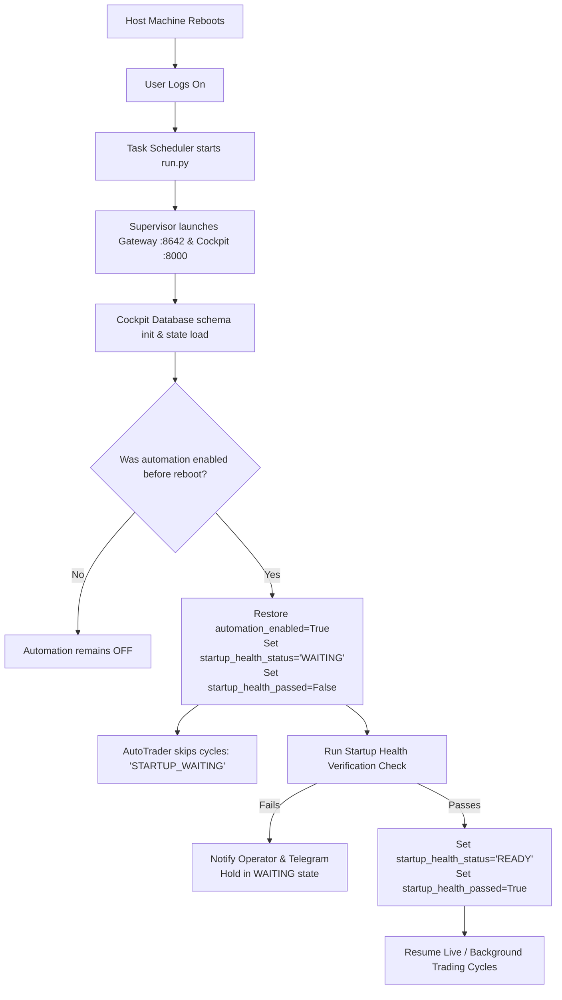

# Humming Bird Trading Cockpit: Autostart, Power Management & Reboot Lifecycle

This document describes the unattended production autostart infrastructure, Windows power configuration, and post-reboot recovery safeguards for the Humming Bird DSE Trading Cockpit.

---

## 1. Automated Startup with Windows Task Scheduler

The Cockpit uses Windows Task Scheduler to start the unified supervisor (`run.py`) automatically upon user logon.

### Installation
Run the automated PowerShell installer:
```powershell
.\scripts\install_autostart.ps1
```

To update or overwrite an existing task:
```powershell
.\scripts\install_autostart.ps1 -Force
```

To remove the scheduled task:
```powershell
.\scripts\install_autostart.ps1 -Uninstall
```

### Task Configuration Specifications
| Parameter | Setting | Purpose |
| :--- | :--- | :--- |
| **Task Name** | `HummingBirdTradingCockpit` | Unique identifier in Windows Task Scheduler |
| **Trigger** | At Logon (`-AtLogOn`) | Automatically fires as soon as the user logs into Windows |
| **Action** | `.venv\Scripts\python.exe run.py --no-reload` | Starts unified supervisor for Hermes Gateway (8642) and Cockpit (8000) |
| **Working Directory** | Workspace root | Ensures all relative paths (`data/`, `logs/`) resolve accurately |
| **Restart Count** | 3 | Windows will restart the supervisor up to 3 times on unexpected failure |
| **Restart Interval** | 1 minute (`PT1M`) | Bounded recovery delay before attempting restart |
| **Battery Policy** | Allow start & run on battery | Continues executing even during momentary UPS/power transitions |
| **Execution Timeout** | Unlimited (`PT0S`) | Prevents Windows from terminating the 24/7 background process |

---

## 2. Power Management (`powercfg`)

Windows default sleep or hibernation breaks unattended trading sessions. The installer automatically applies the following `powercfg` settings:

```cmd
:: Disable standby sleep when plugged into AC power (Never Sleep)
powercfg /change standby-timeout-ac 0

:: Disable hibernation when plugged into AC power (Never Hibernate)
powercfg /change hibernate-timeout-ac 0
```

> [!NOTE]
> Display/monitor sleep is preserved so monitors can turn off to conserve energy without suspending background API polling or trade execution.

To manually inspect your active Windows power scheme:
```cmd
powercfg /query SCHEME_CURRENT SUB_SLEEP
```

---

## 3. Post-Reboot Lifecycle & The `WAITING` Safety Gate

When the host machine reboots (e.g. after a Windows Update or power cycle), the following deterministic sequence occurs:



### Safety Invariants During `WAITING`:
1. **Capital Protection:** `AutoTrader` strictly refuses to execute real orders while `startup_health_status == "WAITING"`. Any scheduled or manual cycles return skip reason `"STARTUP_WAITING"`.
2. **Health Verification:** The startup verification routine audits:
   - SQLite database connectivity and schema integrity
   - StockNow authentication state (or Test Mode configuration)
   - Risk caps (`max_order_bdt`, `max_symbol_bdt`, `daily_budget_bdt`, `max_orders_per_day`)
3. **Transition to `READY`:** Once the verification passes, the status changes to `READY`, and `startup_health_passed` is set to `True`, allowing automated execution to proceed safely.

---

## 4. Watchdogs & Heartbeats

1. **1-Minute Heartbeat:** Every 60 seconds, the Cockpit records a `SystemHeartbeat` row into the SQLite database. Records older than 7 days are pruned automatically.
2. **Dead-Man Alert:** During live DSE market sessions (Sunday–Thursday 10:00–14:30 Asia/Dhaka), if the heartbeat stops for more than 2 minutes, a Telegram dead-man alert is dispatched to notify the operator.
3. **Daily 14:45 Summary:** At 14:45 Asia/Dhaka (15 minutes after market close), a comprehensive summary detailing today's orders, skips breakdown, drift, and errors is dispatched to Telegram and archived to SQLite `DailySummaryLog`.
