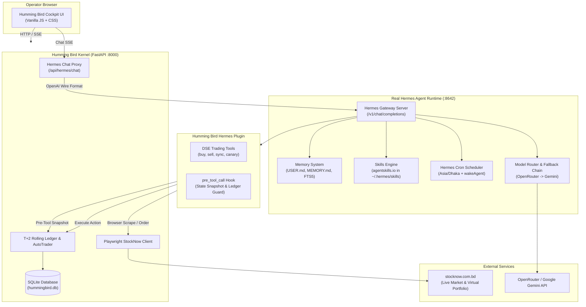

# 🦅 Real Nous Research Hermes Agent Migration Blueprint

This document specifies the exact architecture, verified extension points, file classifications, and phased implementation plan to replace Humming Bird's imitation agent implementation (`backend/hermes/` and `backend/hermes_os/`) with the **official Nous Research Hermes Agent** (`https://github.com/NousResearch/hermes-agent`).

---

## 1. Verified Extension Points

All claims below are directly backed by official Hermes Agent documentation. Unverified capabilities are explicitly marked **UNVERIFIED**.

| Subsystem | Verified Extension Mechanism & Schema | Official Documentation Reference |
| :--- | :--- | :--- |
| **Plugins** | Directory-based bundles with `plugin.yaml` manifest specifying `name`, `version`, `description`, `provides_tools`. Discovered in bundled `<repo>/plugins/<name>/`, user `~/.hermes/plugins/<name>/`, and project `./.hermes/plugins/<name>/` (`HERMES_ENABLE_PROJECT_PLUGINS=1`). Exposed entry point is `register(ctx)` calling `ctx.register_tool(schema, handler)`. Validated via `hermes plugins validate <path>` and `hermes plugins doctor`. | [https://hermes-agent.nousresearch.com/docs/plugins](https://hermes-agent.nousresearch.com/docs/plugins)<br>[https://hermes-agent.nousresearch.com/docs/plugins/build](https://hermes-agent.nousresearch.com/docs/plugins/build) |
| **Adding Tools** | Two official routes: **Plugin Route** (preferred for standalone/domain tools via `plugin.yaml` + `register(ctx)`) and **Core Tool Route** (`tools/<name>.py` calling `registry.register(name, handler, description, parameters, check_fn)` and listed in `toolsets.py`). | [https://hermes-agent.nousresearch.com/docs/tools](https://hermes-agent.nousresearch.com/docs/tools) |
| **Skills** | Procedural memory formatted as `SKILL.md` files with YAML frontmatter conforming to `agentskills.io` standard. Dynamic on-demand prompt injection based on task triggers. Self-improvement closed loop autonomously drafts, indexes, and refines reusable routines. Distributed via Hermes Skills Hub or user directory `~/.hermes/skills/`. | [https://hermes-agent.nousresearch.com/docs/skills](https://hermes-agent.nousresearch.com/docs/skills) |
| **Memory** | Multi-layer memory architecture: persistent structured facts in workspace files (`MEMORY.md` and `USER.md`), SQLite FTS5 cross-session conversation search, and optional plugins (e.g. *Memory Wiki* subject pages and daily work activity logs). | [https://hermes-agent.nousresearch.com/docs/memory](https://hermes-agent.nousresearch.com/docs/memory) |
| **Cron & Scheduling** | Built-in cron scheduler operated via `cronjob_manage` tool or CLI `hermes cron`. Supports recurring or one-shot jobs, attached skills, timezone specification (`--timezone`), pre-check scripts (`--script` with `wakeAgent` JSON protocol), and raw script execution (`no_agent` mode without LLM overhead). | [https://hermes-agent.nousresearch.com/docs/cron](https://hermes-agent.nousresearch.com/docs/cron) |
| **MCP (Model Context Protocol)** | First-class client integration for external MCP servers. Automatically maps tools with dynamic prefix pattern `mcp__<server>__<tool_name>` (e.g. `mcp__hummingbird__execute_buy`). Tool surface is controlled via allowlists in profile configurations. | [https://hermes-agent.nousresearch.com/docs/mcp](https://hermes-agent.nousresearch.com/docs/mcp) |
| **Security & Command Approvals** | Multi-tier defense in depth: `approvals.mode` (`smart`, `manual`, `off`) in `~/.hermes/config.yaml`, fail-closed timeouts, unconditional blocklist for catastrophic commands, and lifecycle interception hooks (`pre_tool_call` and `post_tool_call`). | [https://hermes-agent.nousresearch.com/docs/security](https://hermes-agent.nousresearch.com/docs/security)<br>[https://hermes-agent.nousresearch.com/docs/hooks](https://hermes-agent.nousresearch.com/docs/hooks) |
| **Messaging Gateway & API Server** | Unified messaging hub (`hermes gateway`) owning sessions across CLI, web, desktop, and chat bots. Includes built-in OpenAI-compatible HTTP server (`/v1/chat/completions`) listening on `http://127.0.0.1:8642` enabled via `API_SERVER_ENABLED=true` in `~/.hermes/.env`. | [https://hermes-agent.nousresearch.com/docs/gateway](https://hermes-agent.nousresearch.com/docs/gateway) |
| **Web Dashboard** | Standalone local administrative UI launched via `hermes dashboard` on `http://127.0.0.1:9119` (ports configurable via `--port`). Used for local profile, key, and session inspection without telemetry. | [https://hermes-agent.nousresearch.com/docs/dashboard](https://hermes-agent.nousresearch.com/docs/dashboard) |
| **Providers & OpenRouter** | Multi-provider router supporting OpenRouter (`provider_routing:` with `sort`, `only`, `ignore`, `order`), same-provider credential rotation pools, auxiliary task models, and fallback chains (`fallback_providers:` list or `hermes fallback add/remove`). | [https://hermes-agent.nousresearch.com/docs/providers](https://hermes-agent.nousresearch.com/docs/providers)<br>[https://hermes-agent.nousresearch.com/docs/fallback](https://hermes-agent.nousresearch.com/docs/fallback) |
| **Context Files (`SOUL.md` & `AGENTS.md`)** | **`SOUL.md`:** Global persona, tone, voice, and behavioral identity placed at `~/.hermes/SOUL.md` and injected into Slot #1 (top) of system prompt. **`AGENTS.md`:** Per-project instructions, architecture, commands, and conventions located at project root and injected dynamically based on current working directory. | [https://hermes-agent.nousresearch.com/docs/context-files](https://hermes-agent.nousresearch.com/docs/context-files) |
| **Pre-execution Rollback Hook** | *UNVERIFIED as a built-in atomic database rollback primitive inside Hermes core.* However, **VERIFIED** that a custom `pre_tool_call` hook can synchronously execute an arbitrary Python callback before tool dispatch, enabling our custom plugin to invoke Humming Bird's `CheckpointManager.save_checkpoint()` prior to state mutations. | [https://hermes-agent.nousresearch.com/docs/hooks](https://hermes-agent.nousresearch.com/docs/hooks) |

---

## 2. Answers to Specific Technical Questions (With Evidence)

### (a) Best way for my custom web UI to chat with a running Hermes?
**Answer: The Hermes Gateway Built-in API Server (`/v1/chat/completions`).**
* **Evidence:**
  - Official documentation (`https://hermes-agent.nousresearch.com/docs/gateway`): The Hermes Gateway includes a native HTTP server exposing an OpenAI-compatible endpoint (`/v1/chat/completions`) on `http://127.0.0.1:8642`.
  - Configured simply by placing `API_SERVER_ENABLED=true` and `API_SERVER_KEY=<secret>` in `~/.hermes/.env` and running `hermes gateway`.
  - When the web UI (or Humming Bird backend proxy) posts to `/v1/chat/completions`, Hermes executes the turn with its full native toolset, memory context, and plugins, streaming chunks and tool execution status back over SSE.
* **Why not ACP?** ACP (`hermes acp`) is designed for developer IDEs (VS Code, Zed) communicating over `stdio` with an editor-curated toolset (excluding background messaging and cron).
* **Why not Dashboard?** `hermes dashboard` (`:9119`) is a standalone admin UI for Hermes configuration, not an embeddable component or API endpoint for our custom Cockpit layout.

### (b) Can cron use `Asia/Dhaka` and can a job pre-check market hours?
**Answer: YES to both.**
* **Evidence (Timezone):**
  - Official documentation (`https://hermes-agent.nousresearch.com/docs/cron`): Hermes cron supports per-job timezone pinning using `--timezone <IANA_TZ>` (e.g., `hermes cron create "0 10 * * 0-4" --timezone Asia/Dhaka ...`) as well as global profile timezone setting `timezone: Asia/Dhaka` in `~/.hermes/config.yaml`.
* **Evidence (Market Hours Pre-Check):**
  - Hermes cron features an explicit **Pre-check Script & `wakeAgent` Gate** via the `--script <path>` parameter.
  - Before incurring LLM inference costs, the scheduler executes the pre-check script. If the market is closed (or no action is needed), the script prints `{"wakeAgent": false}` as its final stdout line. Hermes cleanly aborts that tick with zero token expenditure.
  - If the market is open or triggers are hit, the script emits `{"wakeAgent": true, "context": {...}}`, waking the agent and injecting the telemetry directly into the session context.

### (c) Is there a pre-tool-call hook that can block or snapshot?
**Answer: YES.**
* **Evidence:**
  - Official documentation (`https://hermes-agent.nousresearch.com/docs/hooks` and `https://hermes-agent.nousresearch.com/docs/security`): Hermes provides lifecycle execution hooks, specifically `pre_tool_call` and `post_tool_call`.
  - A `pre_tool_call` hook receives the tool name and arguments. It can:
    1. **Snapshot state:** Execute a database/ledger snapshot or checkpoint before tool mutations execute.
    2. **Block execution:** Throw an exception or return a denied status, which fails closed and prevents the tool from executing.

### (d) How is fallback provider configured?
**Answer: Via `fallback_providers` in `~/.hermes/config.yaml` or CLI `hermes fallback`.**
* **Evidence:**
  - Official documentation (`https://hermes-agent.nousresearch.com/docs/fallback`):
    ```yaml
    fallback_providers:
      - provider: openrouter
        model: xiaomi/mimo-v2.6-flash
      - provider: google
        model: gemini-2.5-flash
    ```
  - When primary model requests encounter rate limits, billing caps, or connection errors, Hermes automatically fails over to the sequence specified in `fallback_providers`.
  - For intra-OpenRouter rotation, Hermes also supports multi-key credential pools and the `provider_routing` block (`sort`, `only`, `ignore`, `order`).

---

## 3. Codebase File Classification (KEEP / ADAPT / DELETE)

Following the project governance rule:
> *Deterministic trading logic, StockNow adapters, DB models, and market dashboards are KEEP. Anything re-implementing agent loop, memory, skills, cron, model routing, or tool dispatch is DELETE.*

| File Path | Action | One-Line Architectural Reason |
| :--- | :---: | :--- |
| `backend/__init__.py` | **KEEP** | Package root initialization. |
| `backend/adapters/__init__.py` | **KEEP** | StockNow adapters package entry point. |
| `backend/adapters/stocknow_adapter.py` | **KEEP** | Core interface for Playwright StockNow browser telemetry and quote extraction. |
| `backend/adapters/stocknow_client.py` | **KEEP** | Persistent Chromium CDP browser manager and StockNow authentication. |
| `backend/adapters/stocknow_market_sync.py` | **KEEP** | Scrapes 3 favorites lists and all DSE share boards into SQLite quotes. |
| `backend/adapters/stocknow_executor.py` | **KEEP** | Unified order execution (`BrowserTransport` and `ApiTransport`) with zero paper fallback. Retired legacy `stocknow_order_executor.py`. |
| `backend/adapters/stocknow_portfolio_sync.py` | **KEEP** | Scrapes `/portfolios`, `/show`, `/ledger` and reconciles book basis to exact 0.00 drift. |
| `backend/chat.py` | **DELETE** | Imitation chat router; replaced by thin client calling real Hermes Gateway API. |
| `backend/config.py` | **ADAPT** | Remove imitation LLM/agent fields; keep trading kernel settings, DSE calendar, and auth. |
| `backend/database.py` | **ADAPT** | Keep trading models (`PortfolioState`, `TaxLot`, `TradeLog`, `CompanyProfile`); remove imitation memory/cron tables. |
| `backend/engine/__init__.py` | **KEEP** | Deterministic trading engine package. |
| `backend/engine/agent_actions.py` | **ADAPT** | Keep deterministic buy/sell/canary actions; expose them as tool handlers in the Hermes plugin. |
| `backend/engine/auto_trader.py` | **KEEP** | Autonomous quantitative execution kernel prioritizing `GSC_L1` and `GSC_L2`. |
| `backend/engine/curve_analyzer.py` | **KEEP** | Pure mathematical support/resistance and price curve sparkline evaluator. |
| `backend/engine/money.py` | **KEEP** | Precise Decimal arithmetic and currency formatting. |
| `backend/engine/scheduler.py` | **ADAPT** | Keep market hours clock and trader ticks; remove imitation cron manager hook. |
| `backend/engine/sequential_seller.py` | **KEEP** | Deterministic 4-slice profit locking and no-loss hold guard. |
| `backend/engine/signals.py` | **KEEP** | Mathematical indicator calculations and company health assessment. |
| `backend/engine/t2_ledger.py` | **KEEP** | Pure deterministic 3-bucket rolling T+2 capital ledger with strict invariants. |
| `backend/hermes/__init__.py` | **DELETE** | Imitation Hermes package root. |
| `backend/hermes/agent_loop.py` | **DELETE** | Imitation agent loop and turn runner; replaced by real Hermes Agent runtime. |
| `backend/hermes/memory.py` | **DELETE** | Imitation memory store; replaced by official Hermes `MEMORY.md` & `USER.md`. |
| `backend/hermes/secret_guard.py` | **ADAPT** | Keep as a standalone zero-dependency regex redactor utility for plugin tool inputs. |
| `backend/hermes/skills_manager.py` | **DELETE** | Imitation skill loader; replaced by official `~/.hermes/skills/` loader. |
| `backend/hermes/tools_dispatcher.py` | **DELETE** | Imitation regex tool dispatcher; replaced by Hermes native tool calling. |
| `backend/hermes_os/__init__.py` | **DELETE** | Imitation Hermes OS vendor directory. |
| `backend/hermes_os/agent_loop.py` | **DELETE** | Imitation Hermes OS agent loop. |
| `backend/hermes_os/config.py` | **DELETE** | Imitation Hermes OS YAML configuration loader. |
| `backend/hermes_os/cron_manager.py` | **DELETE** | Imitation SQLite cron manager; replaced by official `hermes cron`. |
| `backend/hermes_os/memory_curator.py` | **DELETE** | Imitation memory curator; replaced by official Hermes cross-session curator. |
| `backend/hermes_os/skill_learner.py` | **DELETE** | Imitation skill learner; replaced by official Hermes closed learning loop. |
| `backend/hermes_os/skill_loader.py` | **DELETE** | Imitation skill loader; replaced by native Hermes skills engine. |
| `backend/hermes_os/toolsets.py` | **DELETE** | Imitation toolsets registry; ported to real Hermes plugin tool definitions. |
| `backend/main.py` | **ADAPT** | Update FastAPI application routes; remove imitation agent initialization. |
| `backend/market_map.py` | **KEEP** | DSE sector taxonomy and company categories. |
| `backend/portfolio.py` | **KEEP** | Deterministic snapshot builder, position aggregations, and company fundamentals. |
| `backend/routes_auth_settings.py` | **ADAPT** | Keep operator authentication and session gate; remove imitation LLM key forms. |
| `backend/routes_hermes.py` | **ADAPT** | Thin proxy forwarding chat turns to Hermes Gateway `/v1/chat/completions`. |
| `backend/routes_stocknow.py` | **KEEP** | Telemetry and browser control endpoints for StockNow Live Playwright sessions. |
| `backend/seed.py` | **KEEP** | Initial portfolio and DSE company profile database seeder. |
| `scripts/generate_code_map.py` | **KEEP** | AST inspection script generating `CODEBASE_MAP.md`. |
| `frontend/index.html` | **ADAPT** | Keep trading cockpit UI; adapt Hermes drawer to stream real Hermes tool events. |
| `frontend/app.js` | **KEEP** | Watchlist tabs, portfolio table, price board, and cockpit controls. |
| `frontend/charts.js` | **KEEP** | Lightweight HTML5 canvas curve sparklines and market charts. |
| `frontend/hermes_ui.js` | **ADAPT** | Stream chat responses and tool execution indicators from real Hermes Gateway API. |
| `frontend/styles.css` | **KEEP** | Dark/light theme styling for trading cockpit. |
| `frontend/theme_light_hermes.css` | **KEEP** | Light mode CSS tokens for cockpit interface. |
| `backend/hermes/skills/*.md` | **ADAPT** | Migrate to `~/.hermes/skills/` conforming to official `agentskills.io` standard. |
| `tests/test_api.py` | **ADAPT** | Keep API route tests; adapt chat assertions to verify Gateway proxy format. |
| `tests/test_engine.py` | **KEEP** | Comprehensive tests for deterministic T+2 ledger, AutoTrader, and seller. |
| `tests/test_stocknow_*.py` | **KEEP** | Unit tests for Playwright browser automation and ledger reconciliation. |
| `tests/test_hermes*.py` | **DELETE** | Tests for deleted imitation agent loop, memory, and OS modules. |

---

## 4. Target Architecture & Phased Implementation Plan

### Target Architecture Diagram



---

### Phased, Independently Testable Implementation Plan

#### Phase 1: Environment & Hermes Gateway Setup
- **Objective:** Install and configure official Hermes Agent runtime as a separate process outside our repo.
- **Actions:**
  1. Install Hermes Agent globally or in dedicated environment (`pip install hermes-agent` or official installation script).
  2. Configure `~/.hermes/profiles/hummingbird/config.yaml` with `timezone: Asia/Dhaka`, `approvals.mode: manual`, and toolsets restricted strictly to `humming_bird`, `memory`, `skills`, and `cronjob` (disabling `terminal`, `file`, `code_execution`, and `browser`).
  3. Enable API server in `~/.hermes/.env` (`API_SERVER_ENABLED=true`, `API_SERVER_KEY=<local_dev_token>`).
  4. Launch `hermes gateway` on port `8642`.
- **Verification / Test:**
  `curl -H "Authorization: Bearer <token>" http://127.0.0.1:8642/v1/models` returns model list and `/v1/chat/completions` streams an initial greeting.

#### Phase 2: Humming Bird Hermes Plugin & Hooks
- **Objective:** Package Humming Bird trading toolsets and safety hooks into a clean, standalone Hermes plugin.
- **Actions:**
  1. Create plugin directory `~/.hermes/plugins/hummingbird/` with `plugin.yaml` declaring tool interfaces:
     - `sync_favorites_3_lists`, `sync_all_dse_shares`, `sync_portfolio_164580`
     - `execute_live_order` (`buy` / `sell` slices)
     - `evaluate_canary_theses`, `quarantine_company`, `restore_company`
     - `inspect_curve_and_support`
  2. Implement `pre_tool_call` hook: before any mutating order tool executes, trigger Humming Bird's `CheckpointManager` snapshot to guarantee instant rollback if needed.
  3. Validate plugin via `hermes plugins validate ~/.hermes/plugins/hummingbird` and `hermes plugins doctor hummingbird`.
- **Verification / Test:**
  CLI query `hermes -q "Check portfolio 164580 holdings"` successfully triggers `sync_portfolio_164580` and outputs real holdings.

#### Phase 3: Cockpit Frontend & Backend Proxy Connection
- **Objective:** Re-route Cockpit chat to real Hermes Gateway while preserving the visual theme and streaming UI.
- **Actions:**
  1. Update `backend/routes_hermes.py` to forward `/api/hermes/chat` requests directly to `http://127.0.0.1:8642/v1/chat/completions` with streaming SSE.
  2. In `frontend/hermes_ui.js`, adapt streaming parser to render Hermes tool call activity badges (e.g. `🔧 Calling sync_favorites_3_lists...`).
  3. Wire `[🧠 Skills]` drawer to query active skills and memory summary from Hermes Gateway.
- **Verification / Test:**
  Open Cockpit in browser, type `"What is my cash balance?"`, and verify streaming response with active tool badge and accurate balance from SQLite.

#### Phase 4: Cron & Market Pre-Check Migration
- **Objective:** Migrate scheduled automations to native Hermes cron with Asia/Dhaka timezone and pre-checks.
- **Actions:**
  1. Author pre-check script `scripts/check_dse_market_open.py`: evaluates `TradingCalendar.is_market_open()` and prints `{"wakeAgent": false}` if market is closed/holiday.
  2. Schedule autonomous monitoring jobs via `hermes cron create "*/5 10-14 * * 0-4" --timezone Asia/Dhaka --script scripts/check_dse_market_open.py "Sync favorites and check canary theses"`.
- **Verification / Test:**
  Run `scripts/check_dse_market_open.py` outside market hours and confirm `{"wakeAgent": false}` output; verify cron execution history via `hermes cron list`.

#### Phase 5: Deprecation & Deletion of Imitation Modules
- **Objective:** Surgically delete imitation agent packages from Humming Bird repo.
- **Actions:**
  1. Delete `backend/hermes/` (except `secret_guard.py`) and `backend/hermes_os/`.
  2. Drop deprecated imitation tables (`HermesSessionMemory`, `HermesUserProfile`, etc.) from `backend/database.py`.
  3. Clean up `backend/config.py` and test suite (`tests/test_hermes*.py`).
  4. Regenerate `documentation/CODEBASE_MAP.md`.
- **Verification / Test:**
  Run `pytest -q` to confirm all deterministic engine, adapter, and API tests pass 100%.

---

## 5. Hermes Runtime

The real Nous Research Hermes Agent runtime is installed beside this project in isolated user space (outside `backend/` and git tracking).

### Installation & Paths
- **Executable:** `C:\Users\inbox\AppData\Local\hermes\bin\hermes.exe` (or `hermes` in PowerShell once in PATH)
- **Hermes Home:** `C:\Users\inbox\AppData\Local\hermes` (aliased as `~/.hermes`)
- **Config file:** `~/.hermes/config.yaml`
- **Secrets & Keys:** `~/.hermes/.env` (keys kept strictly isolated from this repo)
- **Sessions & Cache:** `~/.hermes/sessions/` and `~/.hermes/cache/`
- **Skills directory:** `~/.hermes/skills/`
- **Plugins directory:** `~/.hermes/plugins/`

### How to Run
- **Interactive REPL / TUI:**
  ```powershell
  hermes
  # or
  hermes chat
  ```
- **Single query (oneshot):**
  ```powershell
  hermes chat -q "say ready"
  hermes chat -q "list files in the current directory"
  ```
- **Background Gateway Daemon (with OpenAI-compatible API server):**
  ```powershell
  hermes gateway
  ```
  Listens on `http://127.0.0.1:8642` when `API_SERVER_ENABLED=true` in `~/.hermes/.env`.
- **Administrative Web Dashboard:**
  ```powershell
  hermes dashboard --port 9119
  ```
- **Health Check & Diagnostics:**
  ```powershell
  hermes doctor
  # Auto-repair fixable findings:
  hermes doctor --fix
  ```
- **Model & Config Inspection:**
  ```powershell
  hermes model
  hermes config show
  hermes config set model.default "<provider>/<model>"
  ```

### How to Update
To update the Hermes Agent runtime to the latest stable release:
```powershell
hermes update
```
For checking version and build info:
```powershell
hermes --version
```


