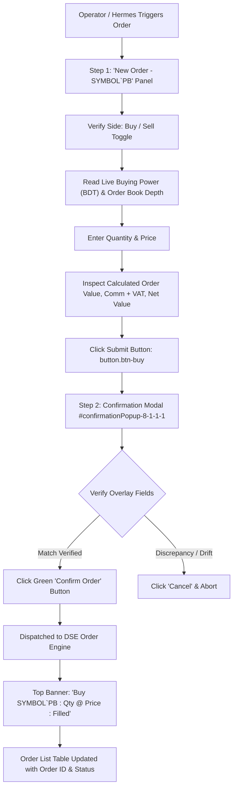
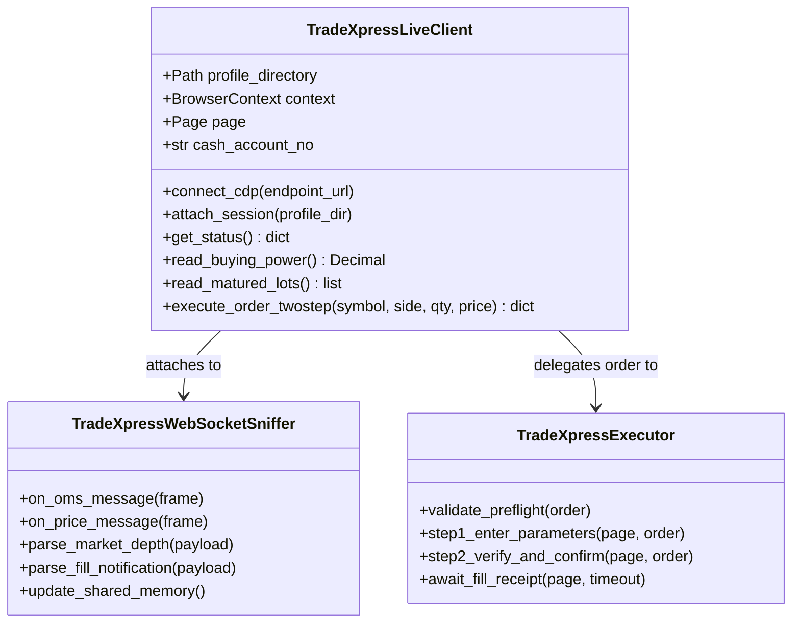

# LankaBangla Securities TradeXpress 2.0 & iBroker Context, Master Site Map & Execution Blueprint

> **Verification Context & Real Live Execution Milestone:**  
> Verified live on LankaBangla TradeXpress 2.0 (`https://itrade.lbsbd.com`) and iBroker (`https://ibroker.lbsbd.com/Home`) on Wednesday, November 18, 2026.  
> **First Live Real DSE Trade Executed & Filled:**  
> `Buy BANKASIA`PB : 9 @ 17.90 : Filled` at `14:01:35` (Post-Closing Session)  
> **Client Code / Cash A/C:** `H9210` · **Market:** DSE Main Public (`PUBLIC`) · **Settlement:** T+2  
> **Zero Secrets Policy:** All session tokens, IDs, hashes, and secrets in this document are strictly `<REDACTED>`.

---

## Table of Contents
1. [Domains & Purpose Split](#1-domains--purpose-split)
2. [Tech Stack & Dual WebSocket Architecture](#2-tech-stack--dual-websocket-architecture)
3. [CRITICAL Symbol Format Discovery: The Backtick (`PB)](#3-critical-symbol-format-discovery-the-backtick-pb)
4. [Auth, Single-Session & Zero-Ban Security Rules](#4-auth-single-session--zero-ban-security-rules)
5. [Verified DSE Market Schedule (10:00–14:10 Asia/Dhaka)](#5-verified-dse-market-schedule-10001410-asiadhaka)
6. [Verified Navigation & Workspace Topology (#tradeOrderTab)](#6-verified-navigation--workspace-topology-tradeordertab)
7. [Exact 2-Step Order Execution Flow](#7-exact-2-step-order-execution-flow)
8. [Fill Verification & Cash Ledger Behavior](#8-fill-verification--cash-ledger-behavior)
9. [Verified Operational Tips, Tricks & Gotchas](#9-verified-operational-tips-tricks--gotchas)
10. [Passive Playwright Adapter Architecture](#10-passive-playwright-adapter-architecture)
11. [Operational Risk Checklist](#11-operational-risk-checklist)

---

## 1. Domains & Purpose Split

LankaBangla Securities operates two distinct web platforms with complementary roles:

```text
+---------------------------------------------------------------------------------------------------+
|                                  LankaBangla Securities Ecosystem                                 |
+-----------------------------------------------------------------+---------------------------------+
|   https://itrade.lbsbd.com (TradeXpress 2.0 / NetPlus HTML5)   |   https://ibroker.lbsbd.com     |
+-----------------------------------------------------------------+---------------------------------+
| - Real-time DirectFN NetPlus HTML5 Single Page Application (SPA)| - Classic ASP.NET Web App       |
| - Bi-directional Dual WebSocket (wss://) market feed            | - Fund Deposit / Withdrawal     |
| - Live execution terminal (Order Placement & Confirmations)     | - Detailed Ledger Statements    |
| - Market Watch (All DSE + Custom Watchlists: GSC, L1, L2)      | - Portfolio Live Valuation      |
| - Level-2 Bid/Offer Order Book Depth & Intraday Tickers         |   (Total Qty, Saleable Qty,     |
| - Real-time Order List (Filled, Open, Pending, Cancelled)       |    AVG Cost, Net Realized Gain) |
| - Dynamic Buying Power (BDT) calculation                        | - Single Sign-On (SSO) Portal   |
+-----------------------------------------------------------------+---------------------------------+
```

### 1.1 `https://itrade.lbsbd.com` (TradeXpress 2.0)
- **Engine:** DirectFN NetPlus HTML5 Single Page Application (Ember.js based).
- **Protocols:**
  - `HTTPS` for initial SPA bundles, static scripts, and periodic XHR catalog queries.
  - `WSS` dual WebSockets for live OMS execution commands and real-time quote depth.
- **Role:** Fast, sub-second execution engine. Primary target for Humming Bird passive sniffing and automated 2-step limit execution.

### 1.2 `https://ibroker.lbsbd.com/Home` (iBroker)
- **Engine:** ASP.NET Server-rendered Web Forms / MVC.
- **Role:** Clearing, back-office ledger, banking transfers (BEFTN, NPSB, bKash, Nagad), capital gain tax reports, and EOD portfolio reconciliation.
- **Key Table (`Portfolio Live`):**
  - Columns: `Company Name`, `Total Qty`, `Saleable Qty` (matured T+2 lots), `AVG Price (Cost Basis)`, `LTP`, `Total Cost`, `Market Value`, `Unrealized Gain / (Loss)`.
  - Used by Humming Bird for daily settlement audit and EOD ledger reconciliation.

---

## 2. Tech Stack & Dual WebSocket Architecture

TradeXpress 2.0 is built on **Ember.js** (`ember-view`, `ember-table`, with bundle scripts like `universal-app-*.js`, `ua-price-*.js`, `ua-trade-*.js`, `ua-chart-*.js`, and `ua-widgets-*.js`).

### 2.1 Dual WebSockets (The 2 Header Status Dots)
In the top-right header, TradeXpress displays two connectivity status dots:
1. **Trade / OMS Socket (Left Dot):**
   - URL: `wss://itrade.lbsbd.com/streaming-api`
   - Framing: JSON message envelope:
     ```json
     {
       "HED": {
         "msgTyp": 1,
         "channel": 30,
         "commVer": "DFNUAWEB_XX_LBSLNTP_X_1.000.05.3",
         "sesnId": "<REDACTED>",
         "ver": "1.0"
       },
       "DAT": { ... }
     }
     ```
   - Message Types:
     - `msgTyp: 1` — Session authentication & heartbeat.
     - `msgTyp: 6` — Customer account & portfolio telemetry.
     - `msgTyp: 31` / `200` — Order placement, cancellation, confirmation responses.
     - `msgTyp: 1006` — Live execution / fill receipt notifications.
2. **Price Feed Socket (Right Dot):**
   - URL: `wss://itrade.lbsbd.com/wsqs`
   - Framing: DirectFN proprietary binary and text streaming feed.
   - Authentication: Session bound via initial SSO token (`SSOTOK=<REDACTED>`).
   - Role: Continuous ticker updates, Best Bid / Best Offer (BBP/BAP), market depth, and index ticks.

### 2.2 Passive Browser XHR Endpoints (NEVER Call Directly; Observe Passively Only)
During active sessions, TradeXpress periodically exchanges XHR queries to populate metadata:
- `/web/price?...&RT=306&SRC=DSE&MOD=WL:...` — Custom Watchlist definitions (`GSC`, `L1`, etc.).
- `/web/price?...&RT=308&SRC=XCHG...` — Exchange market status and turnover summary.
- `/web/price?...&RT=301...` — Full symbol catalog metadata.
- `/web/price?...&RT=52&E=DSE&S=DSE~0~<SYMBOL>%60PB...` — Periodic single-symbol price validation.
- `/web/chart?...&RT=37&E=DSE&S=<SYMBOL>...` — Historical OHLCV candle chart data.

---

## 3. CRITICAL Symbol Format Discovery: The Backtick (`PB)

> [!CAUTION]
> **TradeXpress Symbol Syntax: Backtick (`` ` `` / URL `%60`), NOT Apostrophe (`'`)**  
> On TradeXpress, securities traded on the DSE Public Market use a **BACKTICK**:
> - Real TradeXpress Symbol: ``BANKASIA`PB`` (URL encoded as `BANKASIA%60PB`)
> - Real TradeXpress Symbol: ``MATINSPINN`PB``, ``PRIMEBANK`PB``, ``GP`PB``
> - Incorrect (Will fail in DOM inputs): `BANKASIA'PB`

### Defensive Normalization Contract
The Humming Bird normalization layer (`backend/adapters/base.py`) enforces:
1. `to_tradexpress_symbol("BANKASIA")` $\rightarrow$ ``BANKASIA`PB`` (always emits backtick).
2. `from_tradexpress_symbol(...)` defensively accepts both ``BANKASIA`PB`` and `BANKASIA'PB`, returning clean upper-case `"BANKASIA"`.

---

## 4. Auth, Single-Session & Zero-Ban Security Rules

> [!CAUTION]
> **Strict Anti-Ban & Single-Session Policy**  
> LankaBangla enforces hardware session locks and strict rate-limiting on authentication endpoints. Failure to follow these rules will lock operator account `H9210`.

### 4.1 Manual Login Only (Operator Gateway)
- **Rule:** The bot **NEVER** attempts automated credential submission or password brute-forcing on `itrade.lbsbd.com`.
- **Workflow:**
  1. Operator opens the dedicated browser window at `09:55 AM Asia/Dhaka`.
  2. Operator manually enters User ID (`H9210`), Password, and completes OTP.
  3. Once authenticated and the Market Watch grid loads, the Humming Bird Playwright adapter attaches passively over CDP (`connect_over_cdp("http://127.0.0.1:9222")`).
- **Account Lock Threshold:** 3–5 consecutive failed login attempts result in an immediate automated account freeze requiring phone support and signed documentation.

### 4.2 Single-Session Enforcement
- LankaBangla permits strictly **ONE** active session per trading account.
- If a secondary browser, mobile app, or headless script logs in with `H9210`, the primary session is instantly invalidated.

### 4.3 100% Passive Data Ingestion
- **Zero Active Polling:** The adapter **NEVER** sends periodic HTTP polling loops (`GET /quotes`, `POST /market`) to TradeXpress servers.
- **WebSocket Sniffing:** Data is captured passively by attaching a listener to the browser's native WebSocket connection:
  ```python
  page.on("websocket", handle_tradexpress_ws_frame)
  ```
- **DOM State Reading:** Real-time values (`Buying Power`, `Order Status`, `LTP`) are extracted directly from rendered Ember.js DOM nodes.

---

## 5. Verified DSE Market Schedule (10:00–14:10 Asia/Dhaka)

The official DSE trading timetable operates Sunday through Thursday (`Asia/Dhaka` / UTC+6):

| Session Phase | Time Window | Allowable Order Types | Verified Behavior & Constraints |
|:---|:---|:---|:---|
| **Pre-Market** | `09:45:00 – 09:59:59` | Ingestion / Preflight | Order accumulation; no matching occurs. Humming Bird runs preflight audits. |
| **CONTINUOUS** | `10:00:00 – 13:59:59` | Buy, Sell (Limit Orders) | Real-time continuous order matching based on price-time priority. Primary algorithmic execution window. |
| **POST_CLOSING** | `14:00:00 – 14:10:00` | Closing Price Orders Only | **Critical DSE Rule:** Orders match strictly at the official closing price (last LTP). Orders above or below closing price fail. |
| **CLOSED** | `14:10:01 – 09:44:59` | Read-only | Exchange closed. EOD back-office clearing and trade settlement reconciliation. |

---

## 6. Verified Navigation & Workspace Topology (`#tradeOrderTab`)

TradeXpress organizes the trading workspace under `#tradeOrderTab`:

```text
+---------------------------------------------------------------------------------------------------+
| Top Nav: Market | Trade | Quote | Top Stocks | Heat Map | News | Chart | Daily Client Position    |
+---------------------------------------------------------------------------------------------------+
| TOP WIDGET: Market Watch Container (#watchListContainer-8-1-1-2-cached, [container-id="watchList"])|
| - Header Tabs: Dhaka Stock Exchange | My Favorites | GSC (15 verified symbols) | L1                |
| - Filter Input: input.search-query[placeholder="Filter"]                                          |
| - Toolbar: Board (Main), Asset (All/Equity/...), Sector (All Sectors), Market (Public Board)       |
| - Virtualized Ember Table: .ember-table-left-table-block | .ember-table-right-table-block           |
| - Visible Badges: 52Wk High (span.wk52-up-icon i.icon-high-low-52) | Jump-Up (i.icon-jump-up)     |
+-------------------------------------------------+-------------------------------------------------+
| BOTTOM-LEFT: Order Ticket                       | BOTTOM-RIGHT: Portfolio & Order List Monitor    |
| (#order-ticket-landscape-id,                    | (#portfolioContainer-8-1-2-3,                   |
|  [container-id="orderTicket"])                  |  [container-id="portfolio"])                    |
| - Header: New Order - <SYMBOL>`PB (DSE)         | - Tabs: Order List | Portfolio | Account        |
| - Side: #orderSideToggleSwitch8-1-1-1           |         Summary | Order Search                  |
| - Telemetry: Buying Power, Avail Qty, Gain/Loss | - Portfolio Grid with T+2 Maturity Attributes:   |
| - Inputs: Symbol, Quantity, Price, TIF (DAY)    |   * avaiQtyDSE: Matured T+2 Saleable Qty!       |
| - Submit: button.btn-buy / button.btn-sell      |   * penHolding: Unmatured T+0/T+1 Qty!          |
| - Step 2 Modal: #confirmationPopup-8-1-1-1      |   * avgCst: Real Average Cost Basis             |
+-------------------------------------------------+-------------------------------------------------+
```

### 6.1 Top Widget: Market Watch Grid (`[container-id="watchList"]`)
- **Container ID:** `#watchListContainer-8-1-1-2-cached`
- **Tabs Selector:** `#widget-header-8-1-1-2-cached a[role="tab"]`
  - Tabs: `Dhaka Stock Exchange`, `My Favorites`, `GSC`, `L1`.
  - **15 Verified GSC Symbols:** `MATINSPINN`, `PRIMEBANK`, `NPOLYMER`, `PUBALIBANK`, `IBNSINA`, `BANKASIA`, `DHAKABANK`, `ACI`, `SPCERAMICS`, `GP`, `SQURPHARMA`, `BEXIMCO`, `ROBI`, `FUWANGCER`, `IFIC`.
- **Virtualized Ember Table (`#table-8-1-1-2-cached`):**
  - TradeXpress uses Ember Table virtualization (`lazy-list-container`). Only ~19 rows exist in DOM at any instant.
  - Because `GSC` has 15 symbols, **all 15 GSC symbols fit in DOM without scrolling**.
  - Split into:
    - `.ember-table-left-table-block`: Symbol name (`.symbol-fore-color`) and status badges.
    - `.ember-table-right-table-block`: Numerical data cells.
- **Verified Badges:**
  - `span.wk52-up-icon i.icon-high-low-52` $\rightarrow$ `title="Today's High Reached 52Wk High"` (visual glyph looks like `52`, NOT `S2`!).
  - `i.icon-jump-up` $\rightarrow$ `title="Last Trade Price Reached Max Value"` (upper circuit ceiling hit).
- **Verified Stable Cell Attributes (`cell-id`):**
  - `cell-id="dataObj.sDes"` — Symbol Description (e.g. ``BANKASIA`PB``)
  - `cell-id="dataObj.ltp"` — Last Traded Price
  - `cell-id="dataObj.ltq"` — Last Traded Quantity
  - `cell-id="dataObj.chg"` — Absolute Price Change
  - `cell-id="dataObj.pctChg"` — Percentage Price Change
  - `cell-id="dataObj.vol"` — Cumulative Volume
  - `cell-id="dataObj.bbp"` — Best Bid Price
  - `cell-id="dataObj.bbq"` — Best Bid Quantity
  - `cell-id="dataObj.bap"` — Best Offer/Ask Price
  - `cell-id="dataObj.baq"` — Best Offer/Ask Quantity
  - `cell-id="dataObj.trades"` — Number of Trades
  - `cell-id="dataObj.ltd"` — Last Trade Date (DD-MM-YYYY)
  - `cell-id="dataObj.dltt"` — Last Trade Time (HH:MM:SS)
  - `cell-id="dataObj.open"` — Session Open Price
  - `cell-id="dataObj.high"` — Session High Price
  - `cell-id="dataObj.low"` — Session Low Price
  - `cell-id="dataObj.dispSettType"` — Settlement Type (`PUBLIC` live / `N/A` off-hours)
  - `cell-id="dataObj.dispSymCat"` — Symbol Category (`A`, `B`, `Z` live / `N/A` off-hours)

### 6.2 Bottom-Left Widget: Order Ticket (`[container-id="orderTicket"]`)
- **Container ID:** `#order-ticket-landscape-id`
- **Header:** `#widget-header-8-1-1-1` (`New Order - <SYMBOL>`PB (DSE)`)
- **Side Toggle:** `#orderSideToggleSwitch8-1-1-1` (`input[name="buy-sell-switch"]`)
- **Telemetry Display (`#order-top-panel-8-1-1-1`):**
  - Buying Power: `[data-id="bp-short"] .holding-trade-bp`
  - Available Quantity: `[data-id="available-quantity"] .holding-trade`
  - Gain/Loss: `[data-id="gain-loss"]`
- **Price & Limit Information (`#order-symbol-info`):**
  - Symbol Search Input: `#searchField-8-1-1-1`
  - Pending Order Indicator: `[data-id="order-price-info-level-5"]`
  - Min / Max Circuit Limits: `[data-id="order-price-info-level-4"]`
  - Top Bid / Offer Summary: `[data-id="order-price-info-level-3"]`
  - Session Low / High: `[data-id="order-price-info-level-2"]`
- **Parameter Inputs:**
  - Quantity: `#qtyField-8-1-1-1`
  - Price: `#orderPriceId-8-1-1-1`
  - Disclosed Qty: `#orderDisQtyId-8-1-1-1` (leave blank)
  - Min Fill: `#orderMinQtyId-8-1-1-1` (leave blank)
  - Time in Force (TIF): `button.btn-order-tif` (must be `DAY`)
  - All-or-None: `input[name="allOrNone"]` (must be unchecked / false)
- **Action Buttons (`#executeComp-8-1-1-1`):**
  - Submit Button: `button.btn-buy` (or `button.btn-sell`). Note: Dynamic button ID contains price (e.g. `Buy @ 17.90-8-1-1-1`), so select by class `.btn-buy` inside `#executeComp-8-1-1-1`!
  - Reset Button: `#reset-8-1-1-1`
  - Step 2 Confirmation Modal: `#confirmationPopup-8-1-1-1`

### 6.3 Bottom-Right Widget: Portfolio & Order Monitor (`[container-id="portfolio"]`)
- **Container ID:** `#portfolioContainer-8-1-2-3`
- **Tab Selectors:**
  - `a[container-tab-id="orderList"]` — Active and filled orders
  - `a[container-tab-id="portfolio"]` — Live holding balances
  - `a[container-tab-id="accountSummary"]` — Cash & purchasing power overview
  - `a[container-tab-id="orderSearch"]` — Historical order lookup
- **Verified Portfolio Grid `cell-id` Attributes:**
  - `symbolInfo.dSym` — Security Symbol
  - `profLossQty` — Total Holding Quantity
  - `pendSell` — Pending Sell Quantity
  - `pendBuy` — Pending Buy Quantity
  - `avaiQtyDSE` — **Matured T+2 Saleable Quantity** (Native T+2 maturity tracking!)
  - `avaiQtyCSE` — Available on Chittagong Stock Exchange
  - `penHolding` — **Unmatured T+0/T+1 Quantity**
  - `mktPrice` — Current Market Price
  - `avgCst` — Average Cost Basis
  - `costVal` — Total Acquisition Cost Value
  - `mktVal` — Current Market Value
  - `gainLoss` — Absolute Unrealized Gain / Loss
  - `gainLossPer` — Percentage Unrealized Gain / Loss
  - `portPer` — Percentage of Total Portfolio

---

## 7. Exact 2-Step Order Execution Flow

> [!IMPORTANT]
> **Two-Step Broker Commitment**  
> TradeXpress 2.0 enforces an explicit two-panel verification flow. Clicking `Buy` or `Sell` in the input panel **DOES NOT** transmit the order to the exchange. It transitions the UI into a confirmation review state.



### 7.1 Step 1: Input Panel
1. Side: Verify green `Buy` or red `Sell`.
2. Purchasing Power: Verify `Order Value <= Buying Power`.
3. Parameter Entry: Fill `#qtyField-8-1-1-1` and `#orderPriceId-8-1-1-1`.
4. Submit: Click `button.btn-buy` (or `button.btn-sell`) inside `#executeComp-8-1-1-1`.

### 7.2 Step 2: Confirmation Modal
1. Target: `#confirmationPopup-8-1-1-1`.
2. Read-back Verification: Adapter reads back `Symbol`, `Side`, `Quantity`, `Price`.
3. If parameters match engine intent 100%, click `button.btn-confirm` (or button labeled `Confirm Order`).
4. If any discrepancy is detected, click `button:has-text("Cancel")` and raise an exception.

---

## 8. Fill Verification & Cash Ledger Behavior

### 8.1 Top Notification Toast
- Immediate Fill:
  ```text
  Buy BANKASIA`PB : 9 @ 17.90 : Filled
  ```
- Resting Limit Order:
  ```text
  Buy BANKASIA`PB : 9 @ 17.90 : Queued / New
  ```

### 8.2 Real-time Buying Power & Back-Office Ledger Mechanics
- **Immediate Gross Deduction:**
  TradeXpress deducts the **exact gross order value** upfront from active `Buying Power`:
  $$\text{Buying Power}_{\text{after}} = \text{Buying Power}_{\text{before}} - (\text{Quantity} \times \text{Price})$$
- **EOD Commission & VAT Settlement:**
  - LankaBangla standard commission: `0.40%` (`0.0040`).
  - Government VAT on commission: `15%` (`0.15` on commission, i.e. `0.06%` of gross).
  - Exchange regulatory charges (Laga/CDBL): `0.05%` (`0.0005`).
  - Total effective round-trip fee: ~`1.02%`.

---

## 9. Verified Operational Tips, Tricks & Gotchas

1. **Manual Login Only:**
   The human operator logs in manually at `09:55 AM`. Bot never enters credentials or solves captchas.
2. **Chrome / Edge v136+ CDP Security Rule:**
   Modern Chromium explicitly ignores `--remote-debugging-port=9222` on default user profiles to prevent credential hijacking. To open CDP, always specify an explicit, non-default directory:
   ```cmd
   msedge.exe --remote-debugging-port=9222 --user-data-dir="%LOCALAPPDATA%\Microsoft\Edge\TradeXpressDebug"
   ```
3. **Never Force-Kill While Logged In:**
   Never run `Stop-Process -Force` or kill the browser process while logged into TradeXpress. Doing so leaves the session hanging on the server and blocks re-login. Always click `Log out` cleanly first.
4. **Midnight OMS Maintenance Window (23:45–01:00 Asia/Dhaka):**
   Every night (and Thursday night into Friday weekend), DirectFN takes the OMS gateway offline for clearing. The top banner displays `Trade Disconnected. Retrying..` and login attempts fail with `Authentication timed out. Please Retry...`. **This is normal server maintenance, NOT an account lock.** Do NOT retry repeatedly during maintenance.
5. **Off-Hours / Weekend Field Behavior:**
   When DSE is closed or over weekends, TradeXpress displays `Buying Power: 0.00` and `dispSettType` / `dispSymCat` display `"N/A"`. Testing engines must handle `"N/A"` gracefully via cached metadata rather than throwing exceptions.
6. **Ember Table Virtualization:**
   Only ~19 rows are mounted in `#table-8-1-1-2-cached` at any time. For full market scans, never rely on scrolling the table; rely exclusively on passive sniffing of `wss://itrade.lbsbd.com/wsqs` and `/web/price` payloads.

---

## 10. Passive Playwright Adapter Architecture



---

## 11. Operational Risk Checklist

- [x] **Verified:** DSE Public Market symbols use backtick (`` `PB ``), e.g. ``BANKASIA`PB``.
- [x] **Verified:** 2 status dots correspond to `streaming-api` (OMS) and `wsqs` (Price Feed).
- [x] **Verified:** `avaiQtyDSE` provides exact matured T+2 saleable shares natively in TradeXpress.
- [x] **Verified:** Badge `icon-high-low-52` indicates 52-week high; `icon-jump-up` indicates upper circuit limit.
- [x] **Verified:** Two-step confirmation (`button.btn-buy` -> `#confirmationPopup-8-1-1-1`) is mandatory.
- [x] **Verified:** Midnight maintenance window (`23:45–01:00`) causes `Authentication timed out`.
- [ ] **Pending (Sprint 5):** Live-Data Dummy Mirror Simulator (`SHADOW_DUMMY` mode).
- [ ] **Pending (Sprint 6):** Automated 2-step execution harness with live order verification.
