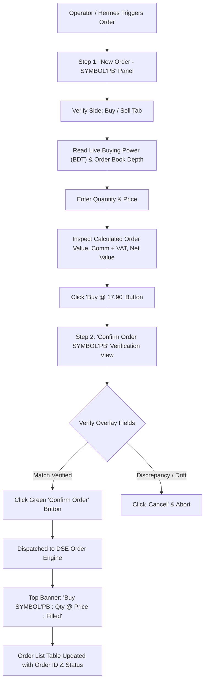
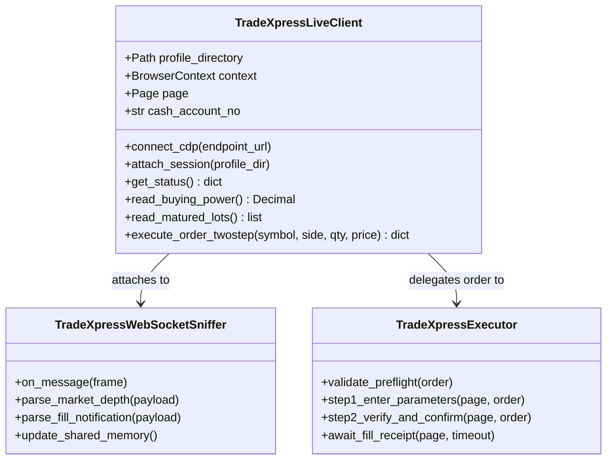

# LankaBangla Securities TradeXpress 2.0 & iBroker Site Map & Automated Execution Blueprint

> **Verification Context & Real Live Execution Milestone:**  
> Verified live on LankaBangla TradeXpress 2.0 (`https://itrade.lbsbd.com`) and iBroker (`https://ibroker.lbsbd.com/Home`) on Wednesday, November 18, 2026.  
> **First Live Real DSE Trade Executed & Filled:**  
> `Buy BANKASIA'PB : 9 @ 17.90 : Filled` at `14:01:35` (Post-Closing Session)  
> **Client Code / Cash A/C:** `H9210` · **Market:** DSE Main Public (`PUBLIC`) · **Settlement:** T+2  

---

## Table of Contents
1. [Domains & Purpose Split](#1-domains--purpose-split)
2. [Auth, Single-Session & Zero-Ban Security Rules](#2-auth-single-session--zero-ban-security-rules)
3. [Verified DSE Market Schedule & Sessions](#3-verified-dse-market-schedule--sessions)
4. [Watchlists, Symbol Formats & Safety Filters](#4-watchlists-symbol-formats--safety-filters)
5. [Exact 2-Step Order Execution Flow (Critical)](#5-exact-2-step-order-execution-flow-critical)
6. [Fill Verification & Cash Ledger Behavior](#6-fill-verification--cash-ledger-behavior)
7. [DOM Topology & Selector Registry](#7-dom-topology--selector-registry)
8. [Passive Playwright Adapter Architecture](#8-passive-playwright-adapter-architecture)
9. [Operational Risk Checklist](#9-operational-risk-checklist)

---

## 1. Domains & Purpose Split

LankaBangla Securities operates two distinct web systems with complementary roles:

```
+---------------------------------------------------------------------------------------------------+
|                                  LankaBangla Securities Ecosystem                                 |
+-----------------------------------------------------------------+---------------------------------+
|   https://itrade.lbsbd.com (TradeXpress 2.0 / NetPlus HTML5)   |   https://ibroker.lbsbd.com     |
+-----------------------------------------------------------------+---------------------------------+
| - Real-time DirectFN NetPlus HTML5 Single Page Application (SPA)| - Classic ASP.NET Web App       |
| - Bi-directional binary/text WebSocket (wss://) market feed     | - Fund Deposit / Withdrawal     |
| - Live execution terminal (Order Placement & Confirmations)     | - Detailed Ledger Statements    |
| - Market Watch (All DSE + Custom Watchlists: GSC, L1, L2)      | - Portfolio Live Valuation      |
| - Level-2 Bid/Offer Order Book Depth & Intraday Tickers         |   (Total Qty, Saleable Qty,     |
| - Real-time Order List (Filled, Open, Pending, Cancelled)       |    AVG Cost, Net Realized Gain) |
| - Dynamic Buying Power (BDT) calculation                        | - Single Sign-On (SSO) Portal   |
+-----------------------------------------------------------------+---------------------------------+
```

### 1.1 `https://itrade.lbsbd.com` (TradeXpress 2.0)
- **Engine:** DirectFN NetPlus HTML5 Engine.
- **Protocol:** `HTTPS` for static bundle assets; `WSS` (`wss://itrade.lbsbd.com/...`) for live market depth, price ticks, and order status events.
- **Role:** Fast, sub-second execution engine. This is the primary target for the Humming Bird execution and passive ingestion adapter.

### 1.2 `https://ibroker.lbsbd.com/Home` (iBroker)
- **Engine:** ASP.NET Server-rendered Web Forms / MVC.
- **Role:** Clearing, back-office ledger, banking transfers (BEFTN, NPSB, bKash, Nagad), capital gain tax reports, and EOD portfolio reconciliation.
- **Key Table (`Portfolio Live`):**
  - Columns: `Company Name`, `Total Qty`, `Saleable Qty` (matured T+2 lots), `AVG Price (Cost Basis)`, `LTP`, `Total Cost`, `Market Value`, `Unrealized Gain / (Loss)`.
  - Used by Humming Bird for daily settlement audit and EOD ledger reconciliation.

---

## 2. Auth, Single-Session & Zero-Ban Security Rules

> [!CAUTION]
> **Strict Anti-Ban & Single-Session Policy**  
> LankaBangla enforces hardware session locks and strict rate-limiting on authentication endpoints. Failure to follow these rules will lock operator account `H9210`.

### 2.1 Manual Login Only (Operator Gateway)
- **Rule:** The bot **NEVER** attempts automated credential submission or password brute-forcing on `itrade.lbsbd.com`.
- **Workflow:**
  1. The human operator opens the dedicated Chrome/Edge browser window at `09:55 AM Asia/Dhaka`.
  2. The operator manually enters User ID (`H9210`), Password, and completes any 2FA/OTP prompt.
  3. Once authenticated and the TradeXpress workspace displays the Market Watch grid, the Humming Bird Playwright adapter attaches to the live session via Chrome DevTools Protocol (`CDP`) or persistent browser context.
- **Account Lock Threshold:** 3–5 consecutive failed login attempts result in an immediate automated account freeze requiring phone support and signed email verification to unlock.

### 2.2 Single-Session Enforcement
- LankaBangla permits strictly **ONE** active session per trading account.
- If a secondary browser, mobile app, or headless script logs in with `H9210`, the primary session is instantly invalidated with a session-termination modal.
- Humming Bird attaches strictly to the operator's active session and never spawns parallel login requests.

### 2.3 100% Passive Data Ingestion
- **Zero Active Polling:** The adapter **NEVER** sends periodic HTTP polling loops (`GET /quotes`, `POST /market`) to TradeXpress servers.
- **WebSocket Sniffing:** Data is captured passively by attaching a listener to the browser's native WebSocket connection:
  ```python
  page.on("websocket", handle_tradexpress_ws_frame)
  ```
- **DOM State Reading:** Real-time values (`Buying Power`, `Order Status`, `LTP`) are extracted directly from rendered DOM nodes already kept fresh by TradeXpress's internal WebSocket client.

---

## 3. Verified DSE Market Schedule & Sessions

The Dhaka Stock Exchange (DSE) trading timetable operates Sunday through Thursday (`Asia/Dhaka` / UTC+6):

| Session | Time Window | Allowable Order Types | Verified Behavior & Constraints |
|:---|:---|:---|:---|
| **Pre-Market** | `09:45 AM – 10:00 AM` | Ingestion / Preparation | Order accumulation; no matching occurs. Humming Bird runs preflight audits. |
| **Continuous Trading** | `10:00 AM – 02:00 PM` | Buy, Sell (Limit Orders) | Real-time continuous order matching based on price-time priority. Primary algorithmic execution window. |
| **Post-Closing Session** | `02:00 PM – 02:10 PM` | Closing Price Orders Only | **Critical DSE Rule:** Orders match strictly at the official closing price (last LTP). Orders above or below closing price are rejected or unfulfilled. |
| **Post-Market / EOD** | `02:10 PM – 09:45 AM` | Read-only | Exchange closed. EOD back-office clearing and trade settlement reconciliation. |

### 3.1 Live Verified Milestone (Post-Closing Execution)
- **Timestamp:** `14:01:35 Asia/Dhaka` (Post-Closing window).
- **Order:** `Buy BANKASIA'PB : 9 @ 17.90 : Filled`.
- **Observation:** TradeXpress accepted and immediately filled the order because the limit price `17.90` matched the exact DSE closing price for Bank Asia PLC.

---

## 4. Watchlists, Symbol Formats & Safety Filters

### 4.1 Symbol Suffix Convention: `'PB`
- On TradeXpress, securities traded on the DSE Public Market carry the **`'PB`** suffix:
  - `BANKASIA'PB` = Bank Asia PLC (Public Board)
  - `GP'PB` = Grameenphone Ltd.
  - `MATINSPINN'PB` = Matin Spinning Mills PLC
  - `ACI'PB` = ACI Limited
- The Humming Bird adapter automatically appends or strips `'PB` when bridging between the internal symbol format (`BANKASIA`) and the broker format (`BANKASIA'PB`).

### 4.2 Workspace Watchlists
The Market Watch panel on TradeXpress features customizable tabs:
1. `Dhaka Stock Exchange`: Full exchange catalog.
2. `My Favorites`: General operator watchlist.
3. `GSC`: Giant Stable Companies (Master Observation pool).
4. `L1`: Primary recovery trend list (highest buy priority).
5. `L2`: Short-term scalp / swing rally list.

### 4.3 Mandatory Safety & Order Filters
Every automated order passed through Humming Bird must satisfy these strict parameters:

```
+----------------------------------------------------------------------------------+
|               Humming Bird -> TradeXpress Mandatory Safety Filters              |
+----------------------+-----------------------------+-----------------------------+
| Filter Name          | Required Value              | Rejection Rationale         |
+----------------------+-----------------------------+-----------------------------+
| Settlement Type      | PUBLIC (Main Market)        | NEVER SPOT (prevents T+0    |
|                      |                             | immediate cash freezes)     |
+----------------------+-----------------------------+-----------------------------+
| Symbol Category      | A (or vetted B)             | NEVER Z (distressed/junk    |
|                      |                             | companies strictly blocked) |
+----------------------+-----------------------------+-----------------------------+
| Order Type           | Limit Order                 | NEVER Market (avoids DSE    |
|                      |                             | illiquid book slippage)     |
+----------------------+-----------------------------+-----------------------------+
| Time in Force (TIF)  | DAY                         | Expires at 02:10 PM; never  |
|                      |                             | GTC (avoids stale fills)    |
+----------------------+-----------------------------+-----------------------------+
| All or None          | Unchecked (False)           | Permits partial fills       |
+----------------------+-----------------------------+-----------------------------+
| Disclosed Qty / Min  | Blank / Default             | Clean standard exchange lot |
+----------------------+-----------------------------+-----------------------------+
```

---

## 5. Exact 2-Step Order Execution Flow (Critical)

> [!IMPORTANT]
> **Two-Step Broker Commitment**  
> TradeXpress 2.0 enforces an explicit two-panel verification flow. Clicking `Buy` or `Sell` in the input panel **DOES NOT** transmit the order to the exchange. It transitions the UI into a confirmation review state.



### 5.1 Step 1: Input Panel (`New Order - <SYMBOL>'PB (DSE)`)
1. **Side Selection:** Select `Buy` (Green) or `Sell` (Red) sub-tab.
2. **Buying Power Verification:** Extract `Buying Power: ৳ XXX.XX`. Ensure `Order Value <= Buying Power`.
3. **Market Depth Check:** Read top 5 Bid/Offer rows. Verify quote is within ±1.5% of LTP (Anti-Typo Price Sanity Guard).
4. **Parameter Entry:**
   - `Quantity`: Enter integer share count (e.g. `9`).
   - `Price`: Enter decimal price (e.g. `17.90`).
5. **Real-time Calculations Displayed:**
   - `Order Value` = `Quantity × Price` (`9 × 17.90 = ৳161.10`)
   - `Commission + VAT` = Estimated broker fee (~0.40% to 0.50% + 15% VAT on fee)
   - `Net Value` = Estimated total debit/credit
6. **Submit Trigger:** Click primary action button labeled `Buy @ 17.90` (or `Sell @ 17.90`).

### 5.2 Step 2: Confirmation Panel (`Confirm Order <SYMBOL>'PB`)
Clicking `Buy @ <price>` dynamically updates the order widget into the **`Confirm Order`** review overlay:
- **Verified Fields Displayed:**
  - `Company Name`: e.g. `Bank Asia PLC`
  - `Sub Market`: `Main`
  - `Exchange`: `DSE`
  - `Side`: `Buy`
  - `Quantity`: `9`
  - `Price`: `17.90`
  - `Order Type`: `Limit`
  - `TIF`: `DAY`
  - `Order Value`: `161.10`
  - `Commission`: Broker commission
  - `VAT`: Value Added Tax on commission
  - `Net Value`: Final debit amount
- **Action Buttons:**
  - `Confirm Order` (Green primary button)
  - `Cancel` (Secondary text/gray button)
- **Execution Obligation:** The Playwright adapter **MUST** click `Confirm Order` to trigger the final network dispatch to the DSE matching engine.

---

## 6. Fill Verification & Cash Ledger Behavior

### 6.1 Top Notification Toast
Upon successful execution, TradeXpress displays a high-priority green confirmation banner at the top of the interface:
```text
Buy BANKASIA'PB : 9 @ 17.90 : Filled
```
- For resting limit orders not immediately matched, the banner reads:
```text
Buy BANKASIA'PB : 9 @ 17.90 : Queued / New
```

### 6.2 Bottom-Right `Order List` Table
The execution is immediately logged in the `Order List` component:

| Column | Verified Live Value | Description |
|:---|:---|:---|
| `Order Id` | `20261118-XXXXX` | DSE / LankaBangla unique order ticket ID |
| `Cash A/C No` | `H9210` | Operator cash trading account number |
| `Side` | `Buy` | Order direction |
| `Symbol` | `BANKASIA'PB` | Full instrument symbol |
| `Quantity` | `9` | Submitted share quantity |
| `Price` | `17.90` | Execution limit price |
| `Status` | `Filled` | Order state (`Filled`, `Open`, `Cancelled`, `Rejected`) |
| `Filled Qty` | `9` | Actually executed share volume |
| `Pending Qty`| `0` | Unexecuted remaining volume |
| `Order Time` | `14:01:35` | Time of exchange acknowledgment |

### 6.3 Real-time Buying Power & Back-Office Ledger Mechanics
- **Immediate Buying Power Deduction:**
  - TradeXpress deducts the **exact gross order value** upfront from active `Buying Power`:
    $$\text{Buying Power}_{\text{after}} = \text{Buying Power}_{\text{before}} - (\text{Quantity} \times \text{Price})$$
  - Verified live: Buying power dropped from `350.00 BDT` to `188.90 BDT` upon executing `161.10 BDT` of `BANKASIA'PB`.
- **EOD Commission & VAT Settlement:**
  - Commission and VAT are computed and deducted during end-of-day clearing.
  - The final net ledger and average cost basis appear in `https://ibroker.lbsbd.com/Home` under `Portfolio Live` on `T+1` morning.

---

## 7. DOM Topology & Selector Registry

The DirectFN NetPlus HTML5 interface uses a component-based layout. Key stable selector patterns observed:

```
+---------------------------------------------------------------------------------------------------+
| Top Navigation Bar: Market Status (DSE OPEN / CLOSED), Current Time, Operator H9210, Buying Power|
+--------------------------------------------------+------------------------------------------------+
| Market Watch (Grid / Tabs)                       | Order Placement Widget                         |
| - Tabs: DSE, My Favorites, GSC, L1, L2           | - Tabs: Buy (Green) / Sell (Red)               |
| - Table: Symbol, LTP, Change, High, Low, Volume  | - Inputs: Symbol, Quantity, Price, TIF         |
| - Right-Click / Double-Click: Open in Order      | - Dynamic: Buying Power, Net Value             |
|                                                  | - Buttons: Buy @ Price -> Confirm Order View   |
+--------------------------------------------------+------------------------------------------------+
| Market Depth (Level 2 Book)                      | Order List & Portfolio Monitor                 |
| - Top 5 Bids (Qty, Price)                        | - Tabs: Order List, Executions, Net Position   |
| - Top 5 Offers (Price, Qty)                      | - Columns: Order ID, Cash A/C, Status, Filled  |
+--------------------------------------------------+------------------------------------------------+
```

### 7.1 Selector Catalog (TradeXpress 2.0)
*Note: Selectors are designed for passive reading and scoped interaction.*

| Logical Target | Component / Role | Recommended Selector Strategy |
|:---|:---|:---|
| Market Status Badge | Top header session indicator | `div:has-text("DSE") >> text=/(OPEN|CLOSED)/i` |
| Operator Cash A/C | Header account indicator | `text="H9210"` |
| Buying Power Display | Real-time cash available | `xpath=//*[contains(text(), 'Buying Power')]/following-sibling::*` |
| Order Widget Tab Buy | Switch to Buy side | `button:has-text("Buy"), div[role="tab"]:has-text("Buy")` |
| Order Widget Tab Sell | Switch to Sell side | `button:has-text("Sell"), div[role="tab"]:has-text("Sell")` |
| Symbol Input Field | Instrument code input | `input[placeholder*="Symbol"], input[name*="symbol"]` |
| Quantity Input Field | Share volume input | `input[placeholder*="Qty"], input[name*="quantity"]` |
| Price Input Field | Limit price input | `input[placeholder*="Price"], input[name*="price"]` |
| Order Value Summary | Calculated gross value | `xpath=//*[contains(text(), 'Order Value')]/following-sibling::*` |
| Initial Buy Button | Step 1 commit button | `button:has-text("Buy @")` |
| Confirm Order View | Step 2 modal container | `div:has-text("Confirm Order")` |
| Confirm Order Button| Final execution dispatch | `button:has-text("Confirm Order"), button.btn-confirm` |
| Cancel Order Button | Abort confirmation | `button:has-text("Cancel")` |
| Success Toast | Execution confirmation | `div[class*="toast"], div[class*="notification"]:has-text("Filled")` |
| Order List Table | Bottom-right executions | `table:has-text("Order Id"), div[role="grid"]:has-text("Filled")` |

---

## 8. Passive Playwright Adapter Architecture

The planned implementation for Version 0.3 (`backend/adapters/tradexpress_adapter.py`) follows this decoupled blueprint:



### 8.1 Key Implementation Invariants
1. **Never Launch Isolated Browser:** The adapter connects to the human-started session via Chrome DevTools Protocol (`--remote-debugging-port=9222`) or user data directory sharing.
2. **Double Verification on Step 2:** Before clicking `Confirm Order`, the adapter reads back the rendered text in the `Confirm Order` modal. If `Quantity`, `Price`, or `Symbol` differs from the engine's intention by even 1 digit, it clicks `Cancel` and logs a critical incident.
3. **Receipt Reconciliation:** Local SQLite `tax_lots` and `trade_logs` are mutated strictly after the `Filled` toast notification or `Order List` row status is verified.

---

## 9. Operational Risk Checklist

- [x] **Verified:** DSE Public Market symbols require `'PB` suffix on TradeXpress.
- [x] **Verified:** Orders execute in Post-Closing session (`14:00 - 14:10`) only if price equals exact closing price.
- [x] **Verified:** Buying power reflects gross order value immediately; commission and VAT settle in back-office.
- [x] **Verified:** Two-step confirmation (`Buy @ <price>` -> `Confirm Order`) is mandatory for dispatch.
- [ ] **Pending (v0.3):** Implement CDP connection harness (`scripts/connect_tradexpress.py`).
- [ ] **Pending (v0.3):** Implement NetPlus binary WebSocket frame decoder for real-time tick ingestion.
- [ ] **Pending (v0.3):** Build daily reconciliation sync between `iBroker` Portfolio Live and Humming Bird SQLite ledger.
